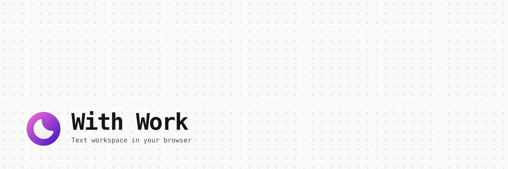
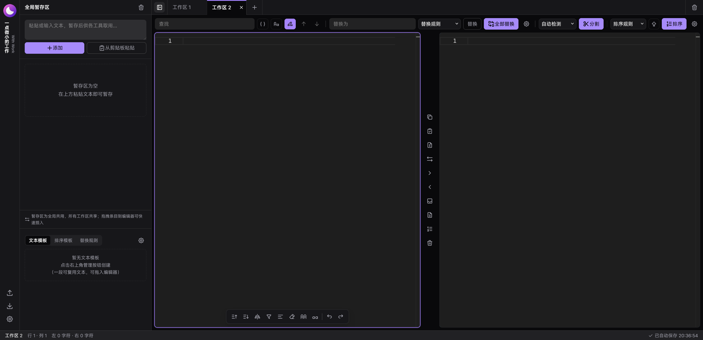

<picture>
  <source media="(prefers-color-scheme: dark)" srcset="assets/banner-dark.svg">
  
</picture>

# With Work

浏览器里的文本工作台，用于整理、比较和转换日常文本。

  
  

> 本项目由 AI 协作完成：代码、文档与迭代均经 AI 生成和优化。

## 功能

- **多工作区**：每个标签页独立保存内容和撤销历史。
- **双栏编辑器**：Monaco 内核，支持查找替换、正则和常用快捷键。
- **文本处理**：分割、组合、排序、去空行、转换大小写和提取差异。
- **暂存区**：复用文本、模板、排序规则和替换规则。
- **数据管理**：自动保存、完整备份和 JSON 导入导出。
- **离线使用**：提供 PWA 和单文件 HTML 两种构建。

## 截图

## 许可证

本项目使用 [MIT 许可证](LICENSE)。
