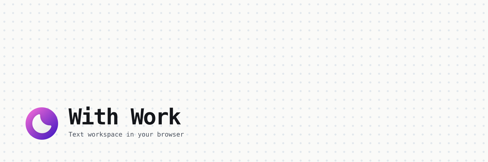
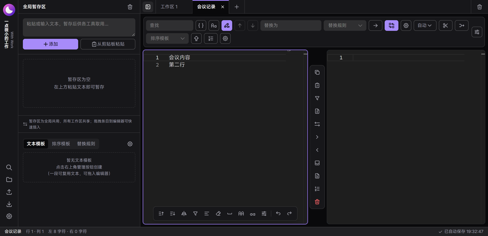

<picture>
  <source media="(prefers-color-scheme: dark)" srcset="assets/banner-dark.svg">
  
</picture>

# With Work

浏览器里的文本工作台，用于整理、比较和转换日常文本。

  
  

> 本项目由 AI 协作完成：代码、文档与迭代均经 AI 生成和优化。

## 功能

- **多工作区**：每个标签页独立保存内容和撤销历史；多标签页同时打开时状态栏提醒覆盖风险。
- **双栏编辑器**：Monaco 内核，支持查找替换、正则和常用快捷键。
- **文本处理**：分割、组合、排序、去空行、转换大小写和提取差异。
- **暂存区**：复用文本、模板、排序规则和替换规则。
- **本地文件**：系统文件选择器打开到新工作区，可写回原文件、管理最近文件，也可直接拖入编辑器。
- **命令面板**：Ctrl/Cmd+K 搜索工具、最近文件、工作区和常用操作。
- **数据管理**：IndexedDB + localStorage 双层自动保存、完整备份和 JSON 导入导出。
- **离线使用**：安装 PWA 后离线可用；设置页可手动检查更新，新版本会先提示再刷新。

## 截图

## 许可证

本项目使用 [MIT 许可证](LICENSE)。
